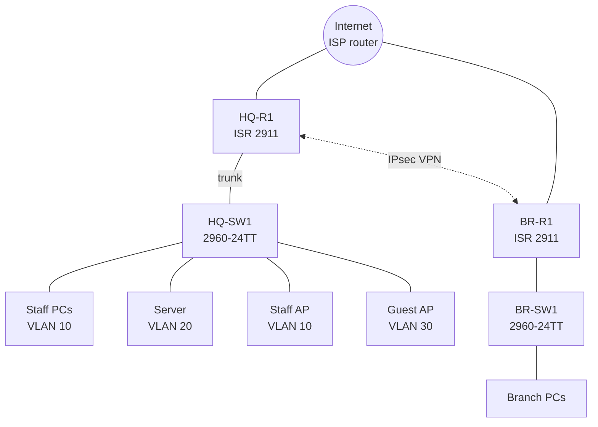

# Lab 01 – MSP client office with a branch

**Status:** To build · **Tool:** Cisco Packet Tracer 8.x · **CCNA topics:** VLANs, trunking, inter-VLAN routing, DHCP and relay, NAT/PAT, ACLs, SSH, site-to-site IPsec VPN

## Scenario

A 25-person accounting firm is a client of a managed service provider. Head office has staff PCs, a file and DNS server, printers, staff Wi-Fi and guest Wi-Fi. A small branch office five suburbs away needs to reach the head-office file server over the internet as if it were local.

This is the kind of site I supported every day at an MSP. In real life the edge firewall was a Sophos. Packet Tracer doesn't have Sophos, so a Cisco ISR router does the same jobs here: routing, NAT, ACLs and the VPN.

## Topology



## Devices

| Device | Packet Tracer model | Role |
|---|---|---|
| ISP | 2911 router | Simulated internet, with a "public web server" behind it |
| HQ-R1 | 2911 router (securityk9 licence) | Edge router: inter-VLAN routing, DHCP for guests, NAT, ACLs, VPN |
| BR-R1 | 2911 router (securityk9 licence) | Branch edge router and VPN peer |
| HQ-SW1, BR-SW1 | 2960-24TT | Access switches |
| HQ-SRV | Server-PT | DNS, DHCP for staff, "file server" (HTTP) |
| APs | AccessPoint-PT | Staff and guest Wi-Fi |

## VLAN and IP plan

| VLAN | Name | Subnet | Gateway | DHCP from |
|---|---|---|---|---|
| 10 | STAFF | 10.10.10.0/24 | 10.10.10.1 | HQ-SRV (via `ip helper-address`) |
| 20 | SERVERS | 10.10.20.0/24 | 10.10.20.1 | Static (HQ-SRV = 10.10.20.10) |
| 30 | GUEST | 10.10.30.0/24 | 10.10.30.1 | HQ-R1 pool |
| 99 | MGMT | 10.10.99.0/24 | 10.10.99.1 | Static (HQ-SW1 = 10.10.99.2) |
| – | Branch LAN | 10.20.10.0/24 | 10.20.10.1 | BR-R1 pool |
| – | HQ WAN | 203.0.113.0/30 | ISP = .1, HQ-R1 = .2 | – |
| – | Branch WAN | 198.51.100.0/30 | ISP = .1, BR-R1 = .2 | – |
| – | "Internet" web server | 192.0.2.10/24 | 192.0.2.1 | – |

## Security rules

| From | To | Allowed? |
|---|---|---|
| Staff (VLAN 10) | Servers, branch, internet | Yes |
| Branch LAN | HQ servers (over VPN), internet | Yes |
| Guest (VLAN 30) | Any 10.x network | **No** |
| Guest (VLAN 30) | Internet | Yes |
| Any user VLAN | Device management (SSH) | Only from VLAN 99 |

## Build steps

**Part A – Switching**
- [ ] Create VLANs 10, 20, 30, 99 on HQ-SW1 and name them.
- [ ] Assign access ports; make the uplink to HQ-R1 an 802.1Q trunk. Set native VLAN 99 and allow only VLANs 10, 20, 30, 99.
- [ ] Shut down unused ports and move them to an unused VLAN.

**Part B – Routing and addressing**
- [ ] Router-on-a-stick on HQ-R1: one subinterface per VLAN with `encapsulation dot1Q`.
- [ ] Static default routes on HQ-R1 and BR-R1 towards the ISP.
- [ ] DHCP: server pool for VLAN 10 on HQ-SRV with `ip helper-address 10.10.20.10` on G0/1.10; router pools for guests and the branch.
- [ ] DNS on HQ-SRV: an A record for `files.acme.local` → 10.10.20.10.

**Part C – Internet and security**
- [ ] PAT (NAT overload) on both routers, with an ACL that **excludes** HQ↔branch traffic so it goes through the VPN.
- [ ] Extended ACL inbound on the guest subinterface: deny 10.0.0.0/8, permit any.
- [ ] SSH only (no Telnet) on routers and the switch, with `access-class` limiting VTY access to VLAN 99.

**Part D – Site-to-site VPN**
- [ ] Enable the securityk9 licence on both routers (`license boot module c2900 technology-package securityk9`, then reload).
- [ ] ISAKMP policy (AES 256, SHA, pre-shared key, DH group 5), transform set and crypto map with an ACL matching 10.10.0.0/16 ↔ 10.20.10.0/24.
- [ ] Apply the crypto map to both WAN interfaces.

## Prove it works

```
show vlan brief
show interfaces trunk
show ip interface brief
show ip dhcp binding
show ip nat translations
show crypto isakmp sa        ! expect QM_IDLE
show crypto ipsec sa         ! encaps/decaps counters increase
show access-lists            ! guest deny counter increases
```

- [ ] Staff PC gets an address from HQ-SRV and opens `http://files.acme.local`.
- [ ] Branch PC opens the file server, and `show crypto ipsec sa` counters go up.
- [ ] Guest PC reaches 192.0.2.10 but **cannot** ping 10.10.20.10.
- [ ] SSH to HQ-SW1 works from VLAN 99 and is refused from VLAN 10.

## Stretch goals
- Replace the HQ router's security role with an ASA 5506-X in front of it.
- Add a syslog server and NTP so logs have the right time.
- Add a second branch and use a hub-and-spoke VPN design.

## What went wrong and how I fixed it
_Fill this in while building. It's the part employers read most closely._
