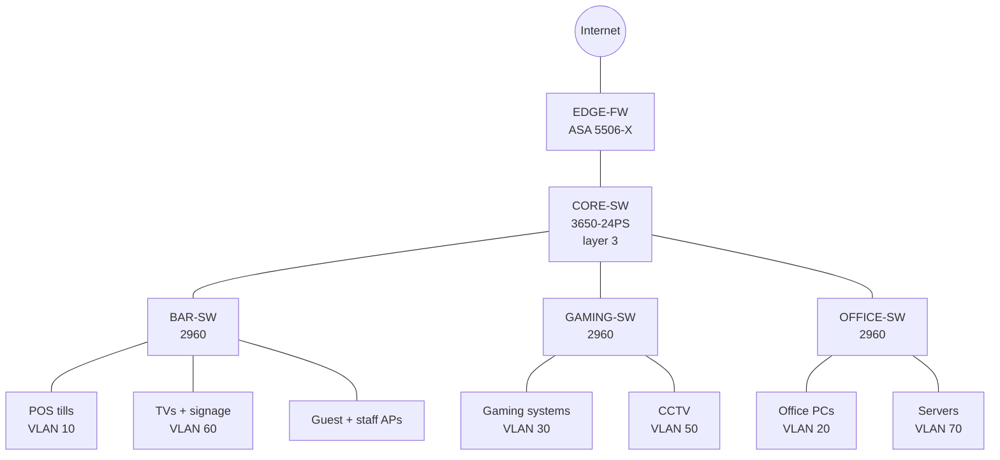

# Lab 03 – Hospitality venue

**Status:** To build · **Tool:** Cisco Packet Tracer 8.x · **CCNA topics:** ASA firewall basics (nameif, security levels, NAT, ACLs), layer 3 switching, port security, DHCP snooping, BPDU guard, guest Wi-Fi isolation

## Scenario

A busy suburban club has two bars, a bistro, a gaming room, a function room, an office and guest Wi-Fi. It also has CCTV everywhere, and TVs and digital signage showing the sport and promotions.

I've worked behind the bar in a venue like this. Point-of-sale tills are used non-stop on a Friday night, and members expect free Wi-Fi. That gives three design priorities:

1. **Protect payments.** POS tills sit on their own network that can only reach what they need.
2. **Keep the public side away from the business side.** Guest Wi-Fi and ports in public areas must never reach the office, POS or cameras.
3. **Stop someone plugging in a laptop behind the bar** and getting onto the network.

## Topology



## Devices

| Device | Packet Tracer model | Role |
|---|---|---|
| EDGE-FW | ASA 5506-X | Internet edge firewall, NAT, outbound rules |
| CORE-SW | 3650-24PS | Inter-VLAN routing and ACLs |
| BAR-SW, GAMING-SW, OFFICE-SW | 2960-24TT | Access switches by area |
| APs | AccessPoint-PT | Guest Wi-Fi and staff Wi-Fi |
| SRV-POS | Server-PT | POS back-office server |
| SRV-NVR | Server-PT | CCTV recorder |
| SRV-MON | Server-PT | Gaming monitoring host (simulated) |
| PAY-GW | Server-PT outside the ASA | "Payment gateway" on the internet (192.0.2.50) |

## VLAN and IP plan

| VLAN | Name | Subnet | Gateway (CORE-SW SVI) |
|---|---|---|---|
| 10 | POS | 10.40.10.0/24 | 10.40.10.1 |
| 20 | OFFICE | 10.40.20.0/24 | 10.40.20.1 |
| 30 | GAMING | 10.40.30.0/24 | 10.40.30.1 |
| 40 | GUEST-WIFI | 10.40.40.0/24 | 10.40.40.1 |
| 50 | CCTV | 10.40.50.0/24 | 10.40.50.1 |
| 60 | MEDIA | 10.40.60.0/24 | 10.40.60.1 |
| 70 | SERVERS | 10.40.70.0/24 | 10.40.70.1 |
| 99 | MGMT | 10.40.99.0/24 | 10.40.99.1 |
| 999 | PARKING | – | – (unused ports) |

Servers: SRV-POS 10.40.70.10, SRV-NVR .20, SRV-MON .30. CORE-SW to ASA inside link: 10.40.255.0/30. ASA outside: 203.0.113.2/30.

## Security rules

| From | Can reach | Cannot reach |
|---|---|---|
| POS | SRV-POS; PAY-GW on HTTPS only | Everything else, including general internet |
| OFFICE | SRV-POS (reports), SRV-NVR, internet | Gaming systems |
| GAMING | **Only** SRV-MON | Internet and all other VLANs |
| GUEST-WIFI | Internet only | **Any** 10.40.x network |
| CCTV | **Only** SRV-NVR | Everything else |
| MEDIA | Internet (streaming) | All internal VLANs |

## Build steps

**Part A – Switching**
- [ ] VLANs on all switches, trunks to the core, and native VLAN 99.
- [ ] Unused ports shut down and moved to VLAN 999.
- [ ] **Port security** on POS ports: maximum 1 MAC, sticky, violation shutdown.
- [ ] **DHCP snooping** on access switches, with only the uplink trusted.
- [ ] PortFast and BPDU guard on every edge port.

**Part B – Layer 3 core**
- [ ] `ip routing`, SVIs, a routed link to the ASA and a default route towards it.
- [ ] DHCP pools on CORE-SW for each VLAN except SERVERS and MGMT.
- [ ] Extended ACLs on the SVIs to enforce the internal rows of the security table.

**Part C – ASA firewall**
- [ ] Interfaces: `inside` (security level 100) towards CORE-SW, `outside` (security level 0) towards the ISP.
- [ ] Static route on the ASA back to 10.40.0.0/16, and a default route to the ISP.
- [ ] Object NAT (dynamic PAT) for the inside networks.
- [ ] Outbound ACL on `inside`: POS only to 192.0.2.50 on TCP 443; GAMING denied; everyone else allowed.

**Part D – Wireless**
- [ ] Guest AP on VLAN 40 with WPA2-Personal; staff AP on VLAN 20.
- [ ] Confirm a guest device can't reach anything internal.

## Prove it works

```
show port-security interface fa0/2
show ip dhcp snooping
show access-lists
! on the ASA:
show nameif
show xlate
show access-list
```

- [ ] Plug a "rogue laptop" into a POS port: the port goes err-disabled.
- [ ] A POS till reaches 192.0.2.50 on HTTPS but can't browse other internet sites.
- [ ] A guest phone browses the internet but can't ping 10.40.70.10.
- [ ] A gaming device reaches SRV-MON only.
- [ ] Add a rogue DHCP server on a guest port: clients ignore it because of DHCP snooping.

## Stretch goals
- Move the guest network to its own ASA interface (a DMZ-style setup) instead of an ACL on the core.
- Add a site-to-site VPN to a "head office" for central POS reporting.
- Syslog from the ASA and switches to a log server.

## Real-world notes
- Card payment systems have their own security standard (PCI DSS). Isolating POS is the first step towards it.
- Gaming machines in NSW venues connect to regulated monitoring systems. This lab only simulates that with an isolated VLAN.
- Venues are busiest at night and on weekends. Plan changes for quiet hours.

## What went wrong and how I fixed it
_Fill this in while building._
